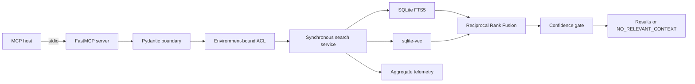

# Governed RAG MCP

[](https://github.com/Rlealbarili/governed-rag-mcp/actions/workflows/ci.yml)
[](https://www.python.org/)
[](LICENSE)

Governed RAG MCP is a small Python reference implementation for governed retrieval over the Model Context Protocol (MCP). It exposes a deliberately narrow FastMCP server over `stdio`: exactly three tools and one machine-readable resource.

The retrieval core is synchronous. Pydantic validates requests at the boundary, an environment-bound source ACL constrains search scope, and strict confidence mode returns `NO_RELEVANT_CONTEXT` instead of passing through weak context. Hybrid retrieval combines SQLite FTS5 and `sqlite-vec` rankings with Reciprocal Rank Fusion (RRF).

This project is suitable for evaluation, local integration, and as a basis for further hardening. Operators still own identity binding, process isolation, index provenance, dependency review, backups, and deployment controls.

[Portuguese version](README.pt-BR.md)

## Engineering evidence

Verified locally on 2026-08-10; every value is reproduced by `make ci`:

| Gate | Verified result |
| --- | --- |
| Unit, integration, and real MCP `stdio` E2E tests | 46 passed |
| Branch-aware Python coverage | 87.59% (minimum gate: 80%) |
| Repository dogfooding | HitRate@5 = 1.00; MRR = 1.00; 6/6 modules at rank 1; ACL denial PASS |
| Static contracts | Ruff clean; strict mypy clean |
| Dependency audit | 0 known vulnerabilities reported by `pip-audit` |
| Publication guard | PASS; no secret value is emitted in its report |
| Container smoke | healthy; UID/GID 10001; read-only filesystem and no network required |

The evaluation corpus is this repository itself. The golden suite asks about RRF, ACL,
grounding, Pydantic contracts, safe ingestion, and telemetry, then verifies that retrieval
lands on the corresponding implementation file. Tests are deliberately excluded from the
search corpus so the expected query text cannot leak into its own answer.

## Why this architecture is production-oriented

- **Small protocol surface:** three read-only tools and one resource over MCP `stdio`.
- **Fail-closed boundaries:** Pydantic rejects malformed input, ACL is bound outside tool
  payloads, and weak evidence is withheld with an explicit absence reason.
- **Hybrid retrieval with provenance:** FTS5 and `sqlite-vec` stay independently measurable;
  RRF combines ranks without pretending their raw score scales are equivalent.
- **Atomic offline indexing:** allowlisted inputs build a shadow database that replaces the
  serving index only after completion and integrity verification.
- **Observable without content capture:** telemetry is aggregate-only and never records query
  or chunk text.
- **Reproducible verification:** CI runs typing, lint, coverage, E2E, retrieval metrics,
  dependency audit, publication audit, and a non-root container build.

Production-oriented does not mean universally production-ready. The operator must still bind
identity, isolate trust domains, protect index provenance, and apply the limits documented below.

## Public surface

The MCP surface is intentionally fixed.

| Type | Name | Purpose |
| --- | --- | --- |
| Tool | `search_knowledge` | Search authorized knowledge using hybrid, FTS-only, or vector-only retrieval. |
| Tool | `list_knowledge_sources` | Return source classes and aggregate chunk counts, never chunk text. |
| Tool | `rag_status` | Return index integrity, aggregate inventory, and process-local aggregate telemetry. |
| Resource | `governed-rag://capabilities` | Describe the transport, tools, resource, retrieval methods, governance controls, and synchronous runtime as JSON. |

There are exactly three tools. Index construction is an offline operation, not an MCP tool.

### `search_knowledge`

| Argument | Type | Default | Constraint |
| --- | --- | --- | --- |
| `query` | string | required | Visible text, 1-500 characters. |
| `limit` | integer | `8` | 1-20 results. |
| `mode` | string | `hybrid` | `hybrid`, `fts`, or `vector`. |
| `source` | string | `all` | `all`, `code`, `docs`, `decisions`, `config`, or `memory`. |
| `project` | string or null | `null` | Optional scope matching `A-Z`, `a-z`, digits, `.`, and `-`; 1-100 characters. |
| `confidence` | string | `strict` | `strict` or `normal`. |

Results carry their source path, line range, project, confidence level, branch scores, and `text_is_untrusted_context: true`. The server returns retrieved text; it does not generate an answer or make retrieved instructions trustworthy.

In `strict` mode, low-confidence candidates are removed. If no candidate remains, the response status is exactly `NO_RELEVANT_CONTEXT`, with an explicit reason such as `strict_blocked_low`, `acl_denied`, `plane_failed`, or `no_results`.

## Architecture at a glance



See [Architecture](docs/architecture.md), [Threat model](docs/threat-model.md), and [Architecture Decision Records](docs/adr/).

## Quickstart

### Local virtual environment

Prerequisites: Python 3.11 or newer, a C-compatible Python environment for `sqlite-vec`, and GNU Make.

```bash
make setup
. .venv/bin/activate
make demo
make test
```

`make demo` builds a deterministic index from the repository's explicit public allowlist. It is dogfooding: only approved source and documentation paths are read. Symlinks, oversized files, NUL-containing content, invalid UTF-8, and recognized secret or private-path patterns fail the ingest.

Run the `stdio` server against the generated index:

```bash
GOVERNED_RAG_CLIENT_PROFILE=restricted \
GOVERNED_RAG_INDEX=data/knowledge.sqlite \
.venv/bin/governed-rag-mcp
```

An MCP host launches that command and exchanges protocol messages over stdin and stdout. Do not place ordinary log output on stdout.

Example host configuration:

```json
{
  "mcpServers": {
    "governed-rag": {
      "command": ".venv/bin/governed-rag-mcp",
      "env": {
        "GOVERNED_RAG_CLIENT_PROFILE": "restricted",
        "GOVERNED_RAG_INDEX": "data/knowledge.sqlite"
      }
    }
  }
}
```

Relative paths are resolved from the server process working directory. Use deployment-appropriate absolute paths in real host configuration without committing machine-specific paths.

### Docker

The image builds its deterministic allowlisted index during `docker build` and runs the server as a non-root user:

```bash
docker build --tag governed-rag-mcp:local .
docker run --rm -i \
  --read-only \
  --tmpfs /tmp:rw,noexec,nosuid,size=16m \
  --security-opt no-new-privileges \
  --env GOVERNED_RAG_CLIENT_PROFILE=restricted \
  governed-rag-mcp:local
```

Keep `-i`: MCP uses stdin and stdout. The packaged index is queried read-only.

## Access control

`GOVERNED_RAG_CLIENT_PROFILE` is a deployment binding, not a caller-supplied tool argument. A missing, empty, or unknown value resolves to `restricted`; it never expands access.

| Profile | Explicitly searchable sources |
| --- | --- |
| `restricted` | `docs`, `decisions` |
| `engineer` | `code`, `docs`, `decisions` |
| `auditor` | `code`, `docs`, `decisions`, `config`, `memory` |

For `source=all`, `config` is excluded even for `auditor` and must be requested explicitly. An unauthorized explicit source returns `NO_RELEVANT_CONTEXT` with `acl_denied` and no results.

The profile applies to the server process. If callers require different trust levels, run separately configured processes and bind identity outside this server. `list_knowledge_sources` and `rag_status` return aggregate source names and counts; they do not apply per-result ACL filtering.

## Retrieval and grounding

- **FTS5:** searchable terms are converted to quoted literals and passed through parameterized SQL.
- **Vector:** `sqlite-vec` performs nearest-neighbor retrieval using the configured embedder.
- **Hybrid:** both ranked lists are merged with RRF (`k0=60`) before the result limit is applied.
- **Confidence:** agreement between both branches is high confidence; a single FTS hit or sufficiently close vector hit is medium; weaker vector-only hits are low.
- **Strict behavior:** low-confidence candidates are withheld rather than presented as grounded context.
- **Degradation:** if embedding fails during hybrid search, FTS results may still be returned with degraded coverage. Vector-only embedding failure returns `NO_RELEVANT_CONTEXT` with `plane_failed`.

Coverage always states which sources were queried or skipped by ACL. It lists failed sources when the failure path can attribute them; hybrid embedding degradation is instead represented by `degraded` and `degraded_reason`. Treat coverage as part of the result contract, not optional diagnostics.

## Embedding providers

The default hashing embedder is deterministic and dependency-free. It exists only for tests and the public self-indexing demo; it is not a substitute for a semantic embedding model and its retrieval quality is intentionally limited.

Set `GOVERNED_RAG_EMBEDDING_PROVIDER=ollama` to use the optional Ollama adapter. Ollama receives the complete text being embedded, including queries and indexed chunks, so its endpoint is a separate privacy and availability boundary. The adapter accepts HTTPS endpoints, or HTTP only for `localhost` and loopback IP literals; it rejects embedded credentials, query strings, and fragments.

| Variable | Default | Meaning |
| --- | --- | --- |
| `GOVERNED_RAG_INDEX` | `data/knowledge.sqlite` | SQLite index path. |
| `GOVERNED_RAG_CLIENT_PROFILE` | restricted on missing or invalid input | Process-wide ACL profile. |
| `GOVERNED_RAG_EMBEDDING_PROVIDER` | `hash` | `hash` or `ollama`; unknown values currently select `hash`. |
| `GOVERNED_RAG_HASH_DIMENSIONS` | `64` | Demo hashing-vector dimensions. |
| `OLLAMA_EMBEDDINGS_URL` | `http://127.0.0.1:11434/api/embeddings` | Ollama embeddings endpoint. |
| `OLLAMA_EMBEDDING_MODEL` | `nomic-embed-text` | Ollama model name. |
| `OLLAMA_EMBEDDING_DIMENSIONS` | `768` | Expected Ollama vector dimensions. |

The query embedder must match the model and dimensions used to build the index. Rebuild the index when either changes.

## Telemetry

Telemetry is aggregate-only and process-local. It records request count, average latency, and counters by profile, requested source, response status, and winning source. It does not record query text or chunk text. Counters reset when the process restarts and are exposed through `rag_status`.

Aggregate telemetry reduces content exposure but is not anonymous usage analytics. Profile and source counters can still reveal coarse usage patterns to callers that can invoke `rag_status`.

## Honest limits

- `stdio` provides no network authentication, authorization, TLS, or rate limiting. Those controls belong at the process or gateway boundary.
- The environment profile is not user identity and is not suitable by itself for mixed-trust callers sharing one process.
- ACLs operate at source-class granularity, not per document, row, tenant, or field.
- Aggregate inventory from `list_knowledge_sources` and `rag_status` is not filtered by caller profile.
- The index has an integrity check but no built-in signature, origin attestation, encryption, retention policy, or backup workflow.
- Retrieved chunks are untrusted context. Downstream hosts must resist prompt injection and enforce their own tool policies.
- The allowlist and pattern checks reduce accidental publication; they are not a complete secret-detection system.
- Optional Ollama availability and privacy depend on the configured endpoint.
- The deterministic hashing embedder is a demo mechanism with limited semantic quality.
- Search is synchronous and intended for bounded local workloads; benchmark with representative data before deployment.

## Project documents

- [Architecture](docs/architecture.md)
- [Threat model](docs/threat-model.md)
- [Security policy](SECURITY.md)
- [Contributing](CONTRIBUTING.md)
- [ADRs](docs/adr/)
