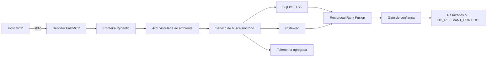

# Governed RAG MCP

[](https://github.com/Rlealbarili/governed-rag-mcp/actions/workflows/ci.yml)
[](https://www.python.org/)
[](LICENSE)

Governed RAG MCP e uma pequena implementacao de referencia em Python para recuperacao governada pelo Model Context Protocol (MCP). Ela expoe um servidor FastMCP deliberadamente restrito via `stdio`: exatamente tres tools e um resource legivel por maquina.

O nucleo de recuperacao e sincrono. Pydantic valida as requisicoes na fronteira, uma ACL de fontes vinculada ao ambiente limita o escopo da busca e o modo de confianca estrito retorna `NO_RELEVANT_CONTEXT` em vez de repassar contexto fraco. A recuperacao hibrida combina os rankings do SQLite FTS5 e do `sqlite-vec` por Reciprocal Rank Fusion (RRF).

Este projeto e adequado para avaliacao, integracao local e como base para endurecimento adicional. Operadores continuam responsaveis por vinculo de identidade, isolamento de processos, proveniencia do indice, revisao de dependencias, backups e controles de implantacao.

[English version](README.md)

## Evidencias de engenharia

Baseline verificada localmente em 2026-08-10; `make ci` reproduz todos os valores:

| Gate | Resultado verificado |
| --- | --- |
| Testes unitarios, integracao e E2E MCP `stdio` real | 45 passaram |
| Cobertura Python com branches | 87,59% (gate minimo: 80%) |
| Dogfooding do repositorio | HitRate@5 = 1,00; MRR = 1,00; 6/6 modulos em rank 1; negacao ACL PASS |
| Contratos estaticos | Ruff limpo; mypy estrito limpo |
| Auditoria de dependencias | 0 vulnerabilidades conhecidas segundo `pip-audit` |
| Guard de publicacao | PASS; nenhum valor secreto aparece no relatorio |
| Smoke do container | healthy; UID/GID 10001; filesystem read-only e sem rede |

O corpus de avaliacao e o proprio repositorio. A suite golden pergunta sobre RRF, ACL,
grounding, contratos Pydantic, ingestao segura e telemetria, e verifica se a recuperacao chega
ao arquivo de implementacao correspondente. Os testes ficam fora do corpus pesquisavel para
impedir que a propria query esperada contamine a resposta.

## Por que esta arquitetura e orientada a producao

- **Superficie pequena:** tres tools somente-leitura e um resource via MCP `stdio`.
- **Fronteiras fail-closed:** Pydantic rejeita entrada malformada, a ACL e vinculada fora do
  payload da tool e evidencias fracas sao retidas com motivo explicito de ausencia.
- **Recuperacao hibrida com proveniencia:** FTS5 e `sqlite-vec` permanecem mensuraveis;
  RRF combina ranks sem fingir que as escalas de score bruto sao equivalentes.
- **Indexacao offline atomica:** entradas em allowlist constroem um banco sombra que so
  substitui o indice servido depois de concluir e passar na verificacao de integridade.
- **Observavel sem capturar conteudo:** a telemetria e agregada e nunca registra texto da
  query ou do chunk.
- **Verificacao reproduzivel:** a CI executa tipagem, lint, cobertura, E2E, metricas de
  retrieval, auditoria de dependencias, auditoria de publicacao e build nao-root.

Orientada a producao nao significa pronta para todo ambiente. O operador ainda precisa vincular
identidade, isolar dominios de confianca, proteger a proveniencia do indice e aplicar os limites
documentados abaixo.

## Superficie publica

A superficie MCP e intencionalmente fixa.

| Tipo | Nome | Finalidade |
| --- | --- | --- |
| Tool | `search_knowledge` | Pesquisar conhecimento autorizado por recuperacao hibrida, somente FTS ou somente vetorial. |
| Tool | `list_knowledge_sources` | Retornar classes de fonte e contagens agregadas de chunks, nunca o texto dos chunks. |
| Tool | `rag_status` | Retornar integridade do indice, inventario agregado e telemetria agregada local ao processo. |
| Resource | `governed-rag://capabilities` | Descrever em JSON o transporte, as tools, o resource, os metodos de recuperacao, os controles de governanca e o runtime sincrono. |

Existem exatamente tres tools. A construcao do indice e uma operacao offline, nao uma tool MCP.

### `search_knowledge`

| Argumento | Tipo | Padrao | Restricao |
| --- | --- | --- | --- |
| `query` | string | obrigatorio | Texto visivel, de 1 a 500 caracteres. |
| `limit` | inteiro | `8` | De 1 a 20 resultados. |
| `mode` | string | `hybrid` | `hybrid`, `fts` ou `vector`. |
| `source` | string | `all` | `all`, `code`, `docs`, `decisions`, `config` ou `memory`. |
| `project` | string ou null | `null` | Escopo opcional com `A-Z`, `a-z`, digitos, `.` e `-`; de 1 a 100 caracteres. |
| `confidence` | string | `strict` | `strict` ou `normal`. |

Os resultados incluem caminho da fonte, intervalo de linhas, projeto, nivel de confianca, scores dos ramos e `text_is_untrusted_context: true`. O servidor retorna texto recuperado; ele nao gera uma resposta nem torna confiaveis as instrucoes encontradas.

No modo `strict`, candidatos de baixa confianca sao removidos. Se nenhum candidato permanecer, o status da resposta e exatamente `NO_RELEVANT_CONTEXT`, com um motivo explicito como `strict_blocked_low`, `acl_denied`, `plane_failed` ou `no_results`.

## Arquitetura em resumo



Consulte [Arquitetura](docs/architecture.md), [Modelo de ameacas](docs/threat-model.md) e [Registros de decisoes de arquitetura](docs/adr/).

## Inicio rapido

### Ambiente virtual local

Pre-requisitos: Python 3.11 ou mais recente, um ambiente Python compativel com extensoes C para `sqlite-vec` e GNU Make.

```bash
make setup
. .venv/bin/activate
make demo
make test
```

`make demo` constroi um indice deterministico a partir da allowlist publica explicita do proprio repositorio. Esse e o dogfooding do projeto: somente caminhos aprovados de codigo-fonte e documentacao sao lidos. Links simbolicos, arquivos grandes demais, conteudo com byte NUL, UTF-8 invalido e padroes reconhecidos de segredo ou caminho privado bloqueiam a ingestao.

Execute o servidor `stdio` com o indice gerado:

```bash
GOVERNED_RAG_CLIENT_PROFILE=restricted \
GOVERNED_RAG_INDEX=data/knowledge.sqlite \
.venv/bin/governed-rag-mcp
```

Um host MCP inicia esse comando e troca mensagens do protocolo por stdin e stdout. Nao envie logs comuns para stdout.

Exemplo de configuracao do host:

```json
{
  "mcpServers": {
    "governed-rag": {
      "command": ".venv/bin/governed-rag-mcp",
      "env": {
        "GOVERNED_RAG_CLIENT_PROFILE": "restricted",
        "GOVERNED_RAG_INDEX": "data/knowledge.sqlite"
      }
    }
  }
}
```

Caminhos relativos sao resolvidos a partir do diretorio de trabalho do processo do servidor. Em configuracoes reais do host, use caminhos absolutos adequados a implantacao sem versionar caminhos especificos de uma maquina.

### Docker

A imagem constroi seu indice deterministico por allowlist durante `docker build` e executa o servidor como usuario sem privilegios:

```bash
docker build --tag governed-rag-mcp:local .
docker run --rm -i \
  --read-only \
  --tmpfs /tmp:rw,noexec,nosuid,size=16m \
  --security-opt no-new-privileges \
  --env GOVERNED_RAG_CLIENT_PROFILE=restricted \
  governed-rag-mcp:local
```

Mantenha `-i`: o MCP usa stdin e stdout. O indice incluido na imagem e consultado como somente leitura.

## Controle de acesso

`GOVERNED_RAG_CLIENT_PROFILE` e um vinculo de implantacao, nao um argumento de tool fornecido pelo chamador. Um valor ausente, vazio ou desconhecido resulta em `restricted`; ele nunca amplia o acesso.

| Perfil | Fontes pesquisaveis quando solicitadas explicitamente |
| --- | --- |
| `restricted` | `docs`, `decisions` |
| `engineer` | `code`, `docs`, `decisions` |
| `auditor` | `code`, `docs`, `decisions`, `config`, `memory` |

Para `source=all`, `config` e excluido mesmo para `auditor` e precisa ser solicitado explicitamente. Uma fonte explicita nao autorizada retorna `NO_RELEVANT_CONTEXT` com `acl_denied` e sem resultados.

O perfil se aplica ao processo do servidor. Se chamadores exigirem niveis de confianca diferentes, execute processos configurados separadamente e vincule a identidade fora deste servidor. `list_knowledge_sources` e `rag_status` retornam nomes de fontes e contagens agregadas; eles nao aplicam filtragem de ACL por resultado.

## Recuperacao e grounding

- **FTS5:** termos pesquisaveis sao convertidos em literais entre aspas e enviados por SQL parametrizado.
- **Vetorial:** `sqlite-vec` executa busca por vizinhos mais proximos com o embedder configurado.
- **Hibrida:** as duas listas ranqueadas sao combinadas por RRF (`k0=60`) antes da aplicacao do limite de resultados.
- **Confianca:** concordancia entre os dois ramos produz confianca alta; um resultado FTS isolado ou um resultado vetorial suficientemente proximo produz confianca media; resultados vetoriais isolados mais fracos tem confianca baixa.
- **Comportamento estrito:** candidatos de baixa confianca sao retidos em vez de apresentados como contexto fundamentado.
- **Degradacao:** se o embedding falhar durante busca hibrida, resultados FTS ainda podem ser retornados com cobertura degradada. Falha de embedding no modo somente vetorial retorna `NO_RELEVANT_CONTEXT` com `plane_failed`.

A cobertura sempre informa quais fontes foram consultadas ou ignoradas pela ACL. Ela lista fontes com falha quando o caminho de erro permite atribui-las; degradacao de embedding em busca hibrida e representada por `degraded` e `degraded_reason`. Trate a cobertura como parte do contrato do resultado, nao como diagnostico opcional.

## Provedores de embedding

O embedder hash padrao e deterministico e nao requer dependencia externa. Ele existe somente para testes e para a demonstracao publica de autoindexacao; nao substitui um modelo de embedding semantico, e sua qualidade de recuperacao e intencionalmente limitada.

Defina `GOVERNED_RAG_EMBEDDING_PROVIDER=ollama` para usar o adaptador Ollama opcional. O Ollama recebe o texto completo a ser vetorizado, incluindo consultas e chunks indexados, portanto seu endpoint e uma fronteira separada de privacidade e disponibilidade. O adaptador aceita endpoints HTTPS, ou HTTP somente para `localhost` e literais IP de loopback; credenciais embutidas, query strings e fragmentos sao rejeitados.

| Variavel | Padrao | Significado |
| --- | --- | --- |
| `GOVERNED_RAG_INDEX` | `data/knowledge.sqlite` | Caminho do indice SQLite. |
| `GOVERNED_RAG_CLIENT_PROFILE` | restricted para entrada ausente ou invalida | Perfil de ACL para todo o processo. |
| `GOVERNED_RAG_EMBEDDING_PROVIDER` | `hash` | `hash` ou `ollama`; valores desconhecidos atualmente selecionam `hash`. |
| `GOVERNED_RAG_HASH_DIMENSIONS` | `64` | Dimensoes do vetor hash de demonstracao. |
| `OLLAMA_EMBEDDINGS_URL` | `http://127.0.0.1:11434/api/embeddings` | Endpoint de embeddings do Ollama. |
| `OLLAMA_EMBEDDING_MODEL` | `nomic-embed-text` | Nome do modelo Ollama. |
| `OLLAMA_EMBEDDING_DIMENSIONS` | `768` | Dimensoes esperadas do vetor Ollama. |

O embedder de consulta deve corresponder ao modelo e as dimensoes usados na construcao do indice. Reconstrua o indice ao alterar qualquer um deles.

## Telemetria

A telemetria e somente agregada e local ao processo. Ela registra quantidade de requisicoes, latencia media e contadores por perfil, fonte solicitada, status de resposta e fonte vencedora. Ela nao registra o texto da consulta nem o texto do chunk. Os contadores reiniciam com o processo e sao expostos por `rag_status`.

Telemetria agregada reduz a exposicao de conteudo, mas nao e analise de uso anonima. Contadores de perfil e fonte ainda podem revelar padroes gerais de uso a chamadores capazes de invocar `rag_status`.

## Limites honestos

- `stdio` nao fornece autenticacao de rede, autorizacao, TLS nem limitacao de taxa. Esses controles pertencem a fronteira do processo ou de um gateway.
- O perfil de ambiente nao representa a identidade do usuario e, sozinho, nao atende chamadores com niveis de confianca distintos no mesmo processo.
- As ACLs operam por classe de fonte, nao por documento, linha, tenant ou campo.
- O inventario agregado de `list_knowledge_sources` e `rag_status` nao e filtrado pelo perfil do chamador.
- O indice tem verificacao de integridade, mas nao inclui assinatura, atestacao de origem, criptografia, politica de retencao ou fluxo de backup.
- Chunks recuperados sao contexto nao confiavel. Hosts consumidores devem resistir a prompt injection e aplicar suas proprias politicas de tools.
- A allowlist e as verificacoes por padrao reduzem publicacao acidental; elas nao formam um detector completo de segredos.
- Disponibilidade e privacidade do Ollama opcional dependem do endpoint configurado.
- O embedder hash deterministico e um mecanismo de demonstracao com qualidade semantica limitada.
- A busca e sincrona e destinada a cargas locais limitadas; faca benchmarks com dados representativos antes de implantar.

## Documentos do projeto

- [Arquitetura](docs/architecture.md)
- [Modelo de ameacas](docs/threat-model.md)
- [Politica de seguranca](SECURITY.md)
- [Como contribuir](CONTRIBUTING.md)
- [ADRs](docs/adr/)
