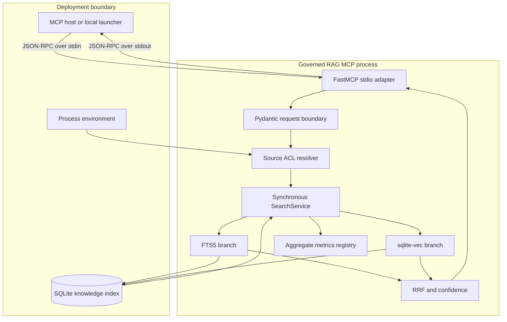
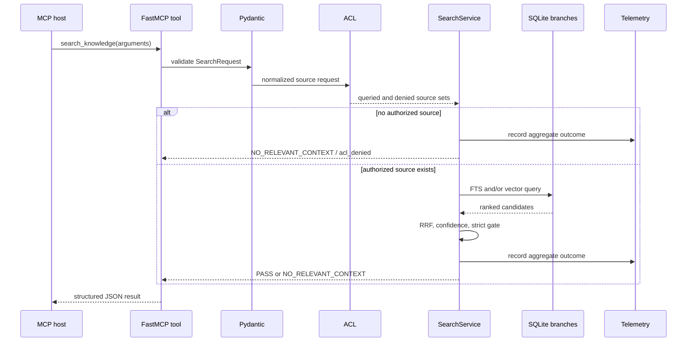

# Architecture

## Purpose

Governed RAG MCP exposes bounded retrieval from a local SQLite index to an MCP host. The design favors a small auditable surface, explicit coverage reporting, and conservative failure behavior over a broad ingestion or agent platform.

The runtime is a synchronous Python core behind FastMCP `stdio`. It has exactly three MCP tools and one resource:

- `search_knowledge`
- `list_knowledge_sources`
- `rag_status`
- `governed-rag://capabilities`

Index construction and evaluation are offline operations, not MCP tools.

## Runtime context

The MCP framework owns protocol framing. Tool functions and the search service are ordinary synchronous functions; the capabilities resource reports `async_runtime: false`.

## Components

### FastMCP adapter

The adapter names the server `Governed RAG MCP`, registers the exact public surface, and runs with `transport="stdio"`. It converts the `search_knowledge` arguments into a strict Pydantic request and serializes the Pydantic response to JSON-compatible data.

The adapter selects configuration from environment variables. Its service instance is cached for the lifetime of the process, including its index path, embedder, and in-memory metrics registry. Restart the process after changing index or embedding configuration.

### Pydantic boundary

`SearchRequest` rejects unknown fields and coercion. It bounds query length, result count, project syntax, retrieval modes, source classes, and confidence modes. Response models keep status, coverage, relevance, result provenance, and scores structurally explicit.

The MCP tool defaults `confidence` to `strict`, even though internal callers may construct a request with a different explicit mode.

### Environment-bound ACL

The client profile comes from `GOVERNED_RAG_CLIENT_PROFILE`, never from tool input. Missing and invalid values resolve to `restricted`.

| Profile | Allowed explicit sources |
| --- | --- |
| `restricted` | `docs`, `decisions` |
| `engineer` | `code`, `docs`, `decisions` |
| `auditor` | `code`, `docs`, `decisions`, `config`, `memory` |

An explicit denied source yields no query branches and a structured `NO_RELEVANT_CONTEXT` response. `source=all` searches the allowed intersection of `code`, `docs`, `decisions`, and `memory`; `config` always requires an explicit request.

This ACL is process-scoped source routing. It is not identity authentication or document-level authorization.

### SQLite index

The index contains:

- a canonical `chunks` table with path, source, project, line range, and text;
- a `chunks_fts` FTS5 virtual table using Unicode tokenization and diacritic removal;
- a `chunks_vec` `sqlite-vec` virtual table with fixed-dimension floating-point embeddings;
- a `metadata` table with schema version, embedding model, dimensions, and build time.

Serving opens the index through a SQLite read-only URI, enables `query_only`, and uses a three-second busy timeout. The vector extension is enabled only while loading `sqlite-vec`, then extension loading is disabled again.

### Retrieval branches

FTS input is reduced to searchable Unicode terms and each term is quoted before it reaches FTS5. SQL values are parameterized. The branch returns up to four times the requested result limit, ranked by BM25.

The vector branch embeds the query, asks `sqlite-vec` for a fixed overfetch of 100 neighbors, then filters by authorized source and optional project. It returns at most four times the requested limit to fusion.

The fixed vector overfetch is a current scalability and recall tradeoff: filters are applied after vector retrieval, so sparse authorized scopes may produce fewer candidates.

### Fusion and confidence

Reciprocal Rank Fusion combines branch positions with `1 / (60 + rank)`. Results are sorted by descending fused score with chunk ID as a deterministic tie-breaker.

Confidence is derived from branch evidence:

- **high:** the chunk appears in FTS and vector results;
- **medium:** the chunk appears in FTS, or its vector distance is at most `0.65`;
- **low:** weaker vector-only evidence.

Strict mode removes low-confidence results. If candidates existed but all were removed, the server returns `NO_RELEVANT_CONTEXT` with `strict_blocked_low`. Empty retrieval returns `no_results`.

### Degradation

An embedding error in hybrid mode marks coverage as degraded and permits the FTS branch to continue. The same error in vector-only mode returns `NO_RELEVANT_CONTEXT` with `plane_failed`. Index availability and other governed errors remain explicit failures rather than fabricated empty success.

### Observability

The in-memory metrics registry is protected by a thread lock and records only:

- request count;
- total latency used to calculate average latency;
- counts by profile;
- counts by requested source;
- counts by response status;
- counts by winning source.

It stores neither query text nor chunk text. `rag_status` returns a snapshot with explicit false flags for both. Metrics reset at process restart and are not a durable audit log.

## Search sequence

## Offline index construction

The public demo indexes the repository itself through an explicit allowlist:

- `src/**/*.py`
- `docs/**/*.md`
- `README.md`
- `README.pt-BR.md`
- `SECURITY.md`

Files must be regular, non-symlinked UTF-8 text no larger than 128 KiB. Content containing a NUL byte and recognized secret, private-network, or private-path patterns fail the operation. Python is parsed with the standard AST and chunked around top-level definitions. Markdown is chunked by headings.

The builder writes a complete temporary index, checks integrity, flushes file and directory state, and atomically replaces the target. Duplicate document IDs fail the build.

These controls prevent accidental broad repository ingestion and partial updates. They do not prove that allowed content is correct or that pattern checks identify every secret.

## Embedding strategies

`HashingEmbedder` creates normalized deterministic vectors from token hashes. It has no external dependency and supports repeatable tests and demos. It does not provide model-grade semantic embeddings.

`OllamaEmbedder` is optional and sends JSON containing the complete input text and model name to the configured endpoint with a ten-second timeout. The initial URL must use HTTPS, except that HTTP is accepted for `localhost`, `127.0.0.1`, and `::1`; credentials, query strings, and fragments are rejected. The adapter validates vector count, finiteness, nonzero norm, and configured dimensions before normalization.

Index and query embeddings must use the same provider behavior, model, and dimensions. Metadata records the build configuration, but the serving path does not currently negotiate or migrate mismatches.

## Capability and status semantics

`governed-rag://capabilities` is static, non-sensitive JSON describing the real MCP contract. It is the preferred discovery artifact for clients.

`list_knowledge_sources` returns source names and chunk counts. `rag_status` adds SQLite integrity, total chunks, source counts, and aggregate telemetry. Neither tool returns chunk text, but neither filters aggregate source inventory according to the process ACL.

## Concurrency and lifecycle

The core performs blocking SQLite and optional HTTP work in the calling thread. The metrics registry is thread-safe, but no throughput or latency guarantee is implied. The service and telemetry are process-local. The index builder should run outside the serving process; replacement is atomic for readers that open a new connection per operation.

## Deliberate exclusions

The project does not currently include:

- network transport or remote identity;
- per-document or multi-tenant ACLs;
- an MCP ingestion or mutation tool;
- answer generation, reranking, or citation synthesis;
- durable telemetry or a compliance audit ledger;
- index signatures, encryption, retention automation, or backup orchestration;
- automatic embedding-model migration;
- guarantees for arbitrary corpus size or concurrency.

See [the threat model](threat-model.md) for security consequences and [the ADRs](adr/) for decision history.
