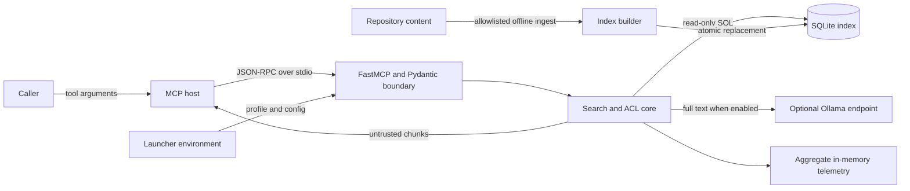

# Threat Model

## Scope

This threat model covers the Governed RAG MCP Python process, its `stdio` MCP surface, environment-bound ACL, local SQLite index, offline repository self-indexer, aggregate telemetry, and optional Ollama embedding adapter.

It does not assume that the MCP host, process launcher, operating system, container runtime, package registry, or Ollama endpoint is trustworthy. Deployment controls around those components remain operator responsibilities.

## Security objectives

1. Return chunk text only from source classes authorized for the process profile.
2. Return no weak context when the caller requests strict confidence.
3. Prevent caller input from becoming executable FTS or SQL syntax.
4. Keep query and chunk text out of built-in telemetry.
5. Serve the index read-only and avoid exposing partially built indexes.
6. Restrict repository dogfooding to reviewed public paths and fail closed on unsafe input.
7. Make degraded and absent context explicit instead of fabricating useful results.

## Assets

- indexed chunk text and its source classification;
- repository source and documentation admitted by the allowlist;
- process ACL profile and embedding configuration;
- SQLite index integrity and availability;
- search result provenance, coverage, and confidence metadata;
- aggregate usage counters;
- text sent to an optional embedding endpoint;
- integrity of the MCP protocol stream.

## Actors

- **Authorized MCP host:** launches the process and submits tool calls.
- **Untrusted MCP caller:** can influence tool arguments through the host but should not control process configuration.
- **Repository contributor:** can propose content under allowlisted paths.
- **Local operator:** configures environment, index, filesystem, and optional embedding endpoint.
- **Compromised local process:** may read or replace accessible files or modify launch configuration.
- **Embedding service operator or attacker:** can observe inputs, delay responses, or return malformed vectors.
- **Dependency attacker:** can compromise a Python package or native SQLite extension in the supply chain.

## Trust boundaries

Each arrow is a trust transition. `stdio` avoids a listening network socket but does not authenticate the process at the other end of the pipes.

## Threats and controls

| Threat | Implemented controls | Residual risk and required action |
| --- | --- | --- |
| Caller requests a forbidden source | Profile is read from environment; denied explicit sources return `NO_RELEVANT_CONTEXT` with `acl_denied`; missing or invalid profiles resolve to `restricted`. | `restricted` still allows documentation and decisions. Protect the launcher and run separate processes for distinct trust domains. |
| Caller impersonates a more privileged role | Profile is absent from tool arguments and cannot be selected in `search_knowledge`. | A caller that can alter the process environment or launcher already crosses this boundary. There is no user identity inside the server. |
| Sensitive inventory leaks through status tools | Status and source listing expose aggregates only, with no chunk text. | Source names, counts, profile counters, and winning-source counters may be sensitive and are not ACL-filtered. Restrict access at the host boundary. |
| SQL or FTS injection | Pydantic bounds inputs; FTS terms are extracted and quoted; SQL values are parameterized; the serving connection is query-only. | Parser or dependency defects remain possible. Keep tests and dependency review current. |
| Prompt injection in indexed content | Results set `text_is_untrusted_context: true`; the server does not execute chunks or generate an answer. | The MCP host can still mishandle retrieved instructions. Keep policy outside retrieved context and authorize every downstream action independently. |
| Weak retrieval is presented as fact | Strict mode is the tool default; low-confidence chunks are removed; absence has structured status and reason. | Confidence is heuristic, not truth verification. High confidence only means branch agreement. Consumers must inspect provenance and validate important claims. |
| Retrieval plane fails silently | Vector-only embedding failure returns `plane_failed`; hybrid embedding failure marks coverage degraded and falls back to FTS; other governed failures remain explicit. | A consumer that ignores `coverage` can misread partial retrieval. Treat coverage as mandatory. |
| Index is corrupted or replaced | Read-only serving, SQLite integrity check, complete shadow build, fsync, and atomic replacement. | Integrity is not authenticity. Apply filesystem permissions, controlled builds, backups, and optionally external signatures. |
| Repository ingest includes private material | Explicit path allowlist; 128 KiB limit; regular-file and UTF-8 checks; symlinks, NUL-containing content, and recognized secret, private-network, and private-path patterns are rejected. | Pattern matching is incomplete and allowed text may still be confidential. Review staged content and run an independent secret scanner before publication. |
| Symlink escapes repository root | Any allowlisted candidate that is a symlink is rejected. | Files can change between checks and reads in a hostile writable tree. Build from an immutable or access-controlled checkout. |
| External embedder receives sensitive text | Hashing embedder is local by default; Ollama is opt-in; its initial URL requires HTTPS except for loopback HTTP and rejects credentials, query strings, and fragments. | Ollama receives complete queries and chunks. Assess endpoint identity, DNS, redirects, transport, logs, retention, and tenancy. |
| Embedding service returns malformed data | Timeout, JSON shape checks, numeric conversion, dimension checks, finite-value checks, nonzero norm, and normalization. | The service can return semantically malicious but numerically valid vectors. Pin and govern the model and endpoint. |
| Resource exhaustion | Query length is at most 500, limit at most 20, vector overfetch is fixed, index access has a busy timeout, Ollama has a timeout, and ingest limits individual file size. | No request quota, global deadline, corpus-size cap, or memory budget exists. Isolate the process and add quotas at a gateway if exposed remotely. |
| Telemetry captures sensitive text | Registry accepts only categorical labels and latency; snapshots assert that query and chunk text are not recorded. | Coarse usage patterns remain visible, and external logs are outside this registry. Audit host and container logging separately. |
| Protocol corruption through stdout logs | The intended runtime is `stdio`; documentation requires ordinary logs to avoid stdout. | Third-party libraries or operator code can still print to stdout. Validate integration under the real host. |
| Dependency compromise | Core dependencies are version-pinned and a dependency audit tool is part of development dependencies. | Pinning does not establish provenance. Review lock/build inputs, native extension artifacts, and vulnerability reports. |

## Abuse cases

### Unauthorized configuration search

An `engineer` process requests `source=config`. ACL resolution produces no queried sources and records `config` in `skipped_by_acl`. The response contains no results and has `status=NO_RELEVANT_CONTEXT` plus `no_relevant_context_reason=acl_denied`.

An `auditor` process must still request `config` explicitly because `source=all` excludes it. This reduces accidental configuration disclosure.

### Low-confidence vector match

A query produces only a vector candidate above the medium-confidence distance threshold. With the public tool's default `confidence=strict`, the candidate is withheld and the response reason is `strict_blocked_low`. The server does not return the weak chunk with a warning.

### Embedding endpoint outage

In `hybrid` mode, a recognized embedding error degrades coverage and allows available FTS evidence to proceed. In `vector` mode, no alternate branch exists and the response is `NO_RELEVANT_CONTEXT` with `plane_failed`.

### Malicious documentation

A contributor adds an instruction under an allowlisted documentation path. The indexer may admit it if it passes file safety checks. Search returns the text marked untrusted. Preventing the host from obeying that instruction is a downstream prompt-injection control, not an indexer guarantee.

### Valid but forged index

A local actor replaces the database with a structurally valid SQLite index containing false content. The integrity check can pass. Authenticity requires controlled build provenance, filesystem protection, and an external signature or digest policy, none of which is built in.

## Privacy analysis

The local hashing path keeps text inside the process and index. The index itself stores chunk text in plaintext. Filesystem access therefore grants content access independent of MCP ACLs.

The Ollama path transmits full text for every embedding call. That includes document chunks during index construction and user queries during vector or hybrid search. The endpoint URL is operator-controlled and defaults to loopback. The initial URL requires HTTPS for remote hosts and permits HTTP only for `localhost` or loopback IP literals. The adapter does not independently pin DNS resolution or revalidate every redirect destination.

Built-in telemetry excludes text, while aggregate dimensions can identify patterns such as which profile searched which source class and whether searches succeeded. The registry is process-local and has no retention controls because it is not persisted.

## Assumptions

- The process launcher protects environment variables and stdin/stdout attachment.
- The serving account has read access only to the intended index and required runtime files.
- Operators do not share one privileged process across mutually untrusted callers.
- The index is built from reviewed public inputs or another governed corpus.
- MCP hosts honor `NO_RELEVANT_CONTEXT`, coverage, and untrusted-context markers.
- Dependency artifacts come from reviewed sources.

If any assumption is false, compensate outside the server or do not use that deployment topology.

## Verification priorities

- Contract-test exactly three tools and `governed-rag://capabilities`.
- Test every profile, `source=all`, explicit `config`, and invalid profile fallback.
- Test strict removal of low-confidence results and all absence reasons.
- Assert query and chunk text never enter telemetry snapshots.
- Exercise malformed FTS input, embedding failures, index absence, and corrupt indexes.
- Test allowlist bypass attempts, symlinks, NUL-containing data, large files, invalid UTF-8, and secret patterns.
- Run dependency audits and container checks before release.
- Validate stdout cleanliness with a real MCP host.

## Out of scope for built-in controls

- network identity, authentication, TLS, and rate limiting;
- host-level authorization of other MCP tools;
- prevention of a privileged local administrator replacing code or data;
- semantic truth verification of retrieved content;
- complete secret discovery;
- encryption, key management, retention, deletion, and backup policy;
- privacy guarantees made by an external embedding service.

Revisit this model when adding a network transport, persistent telemetry, mutation tools, new source classes, remote indexes, or multi-tenant identity.
